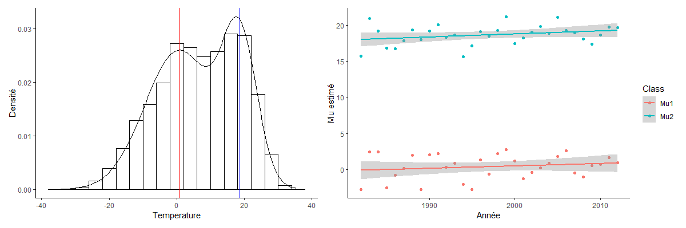
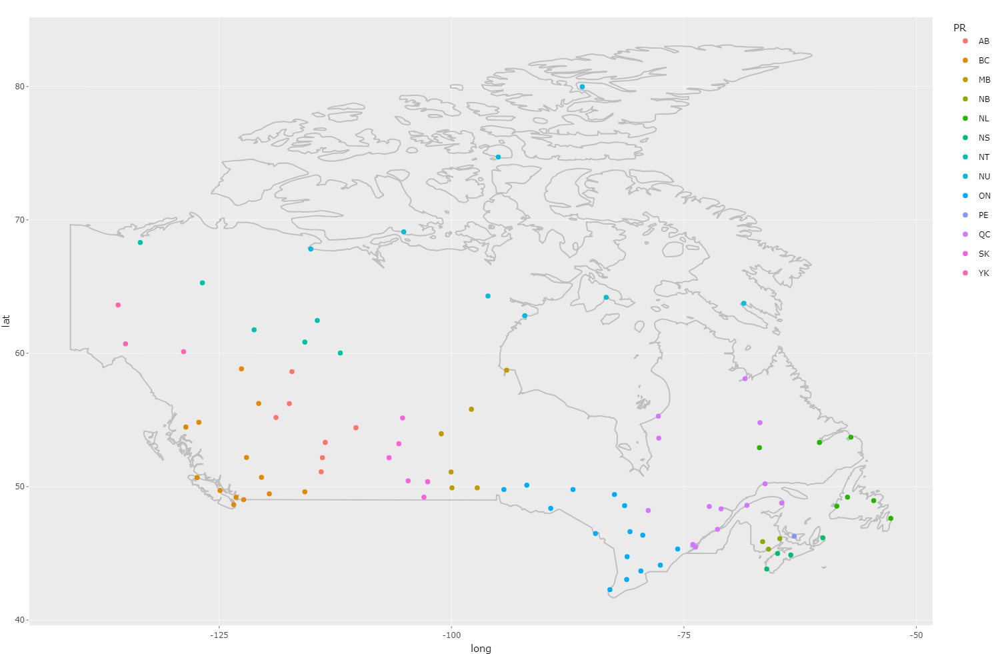
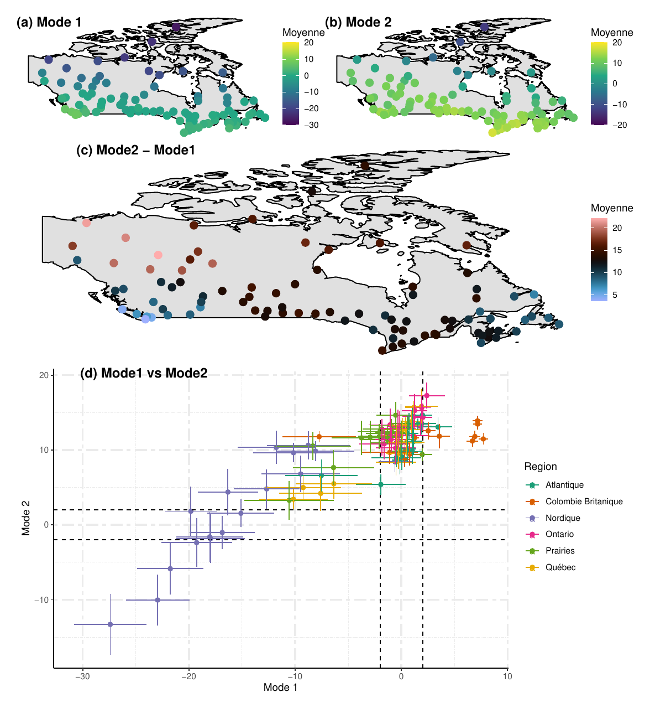
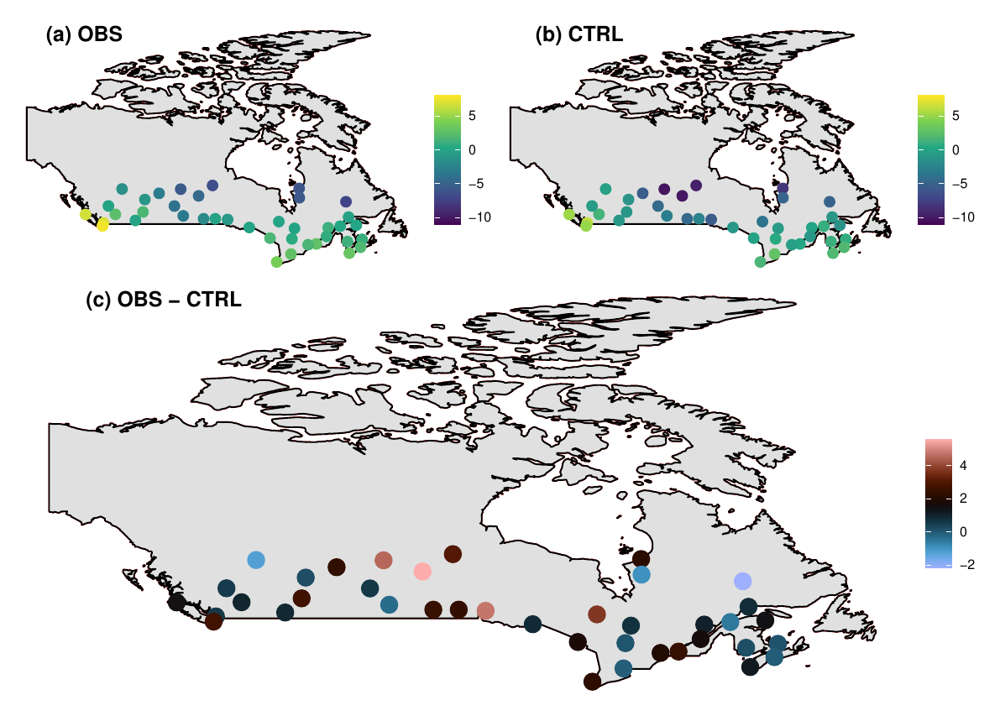
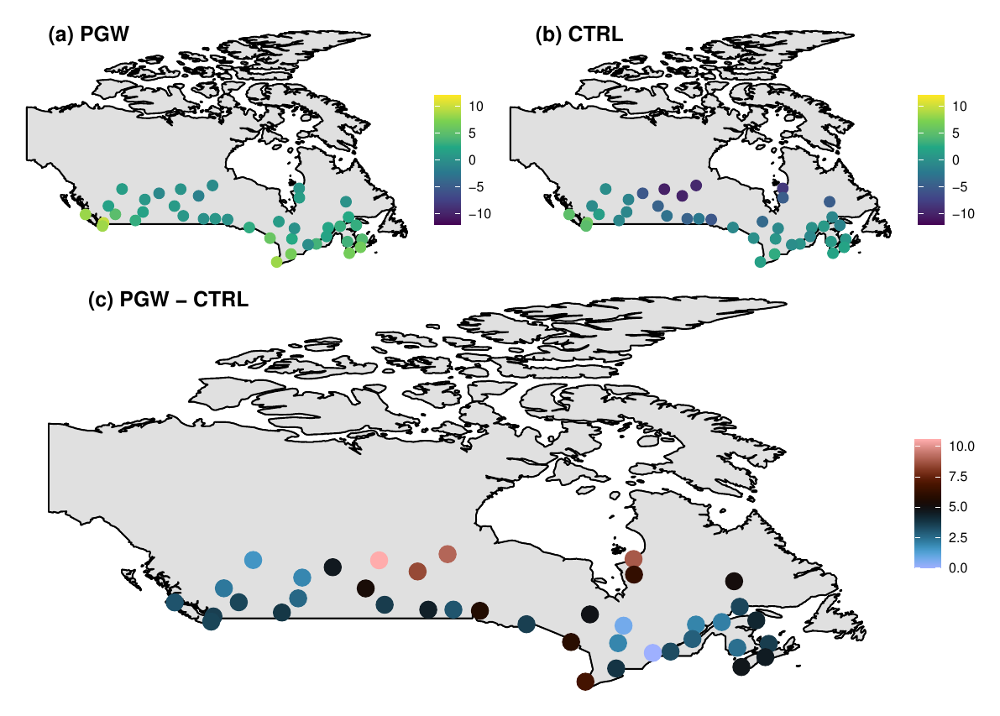

# Peaks in surface temperature distributions across Canada

This is my research internship for the master's in mathematics at UQAM (2022–2023). I worked out how to find and describe the peaks in hourly air temperature distributions, using 31 years of data from 92 Canadian weather stations. I did this work during my internship at UQAM, for J. M. Thériault and F. Larribe. Fabrice Larribe supervised the project and Julie M. Thériault provided the data.

The full report (76 pages, in French) is not public. This page summarizes the question, the data, the methods and what I found.

## The question

If you plot a histogram of all the hourly temperatures at a station, most Canadian stations show two peaks: a cold one and a warm one. The cold peak often sits close to 0 °C. That matters because temperatures around freezing drive freeze–thaw cycles, which affect soils, roads and the type of precipitation that falls.

I wanted to answer three things:
- Where are the two peaks at each station, and how far apart are they?
- How do they change across the country?
- Did they move between 1981 and 2011?

## Data

- 92 Environment and Climate Change Canada stations, hourly temperatures, 1981–2011.
- About 25 million observations in total (24 × 365.25 × 31 × 92).
- The raw data is not included in this repository.

## Methods

I compared three ways of locating the two peaks:

1. **Kernel density with Silverman's critical bandwidth.** I estimated the density with a Gaussian kernel and took the smallest bandwidth that still gives two modes. This is the method I kept for the final results.
2. **Gaussian mixtures (k = 2, 3, 4)**, fitted with the EM algorithm. The peaks are read from the fitted components.
3. **Two-season split.** I divided each year into a cold and a warm season per station, and took the mode of each season.

For trends over time, I estimated the peaks year by year and used Spearman's rank correlation between each peak and the year.

## What I found

- Most stations have two peaks.
- The cold peak ranges from −27 °C at Eureka to 7 °C at Victoria. The warm peak goes up to 17 °C at Windsor.
- The two peaks move together: the Spearman correlation between them is 0.87.
- The gap between the peaks is 10 to 15 °C at most stations. It's above 15 °C inland in the north, and below 10 °C in British Columbia, down to 3 °C. On average it's about 13 °C.
- 53 stations have their cold peak between −2 and +2 °C, and 27 stations have it below −2 °C.
- Over 1981–2011, I found no clear trend at most stations. Only Cold Lake showed a significant change, a narrowing gap.

## Climate-model scenarios

I also compared the observed peaks with regional climate-model runs (WRF, 39 stations, 2000–2013): a control run of the current climate (CTRL) and a pseudo-global-warming run (PGW).

- The control run reproduces the observed peaks reasonably well. Most cold-peak differences are within ±2 °C, with larger gaps at a few Prairie stations.
- Under warming, both peaks shift up by 3 to 6 °C at most stations, and the winter peak by up to 10 °C in the northern Prairies.

## Code

The `scripts/` folder has the scripts I used to prepare the data, fit the mixtures and make the figures. They show how the results were produced. The scripts in `scripts/` run in order, 01 to 05, from the repo root. They need the ECCC hourly station files in `data/`, which aren't included.

I later cleaned up and tested the kernel-density and mode functions, and built an interactive app on them, as a separate project.

## Tools

R (mclust, ks, data.table, dplyr, ggplot2), R Markdown, flexdashboard.
